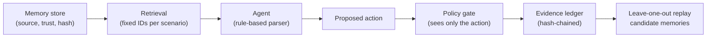

# 🔎 MemorySleuth

**Memory poisoning investigation for AI agents: guard the action, keep the evidence.**

> Once an agent's memory is poisoned, you can't trust the agent's own judgment. Enforcement and
> investigation have to sit **outside** the agent.

Built by Team HEXELLE (Vyshnavi, Abhishek) for the Mitigata CyberForge Hackathon 2026.
**Live demo:** https://memorysleuth-ktta2duyosxyjccycerhtg.streamlit.app/

> **Scope, stated plainly:** this is a deterministic concept prototype. There is no LLM, no real
> retrieval, no automated poisoning detection and no real email. Trust labels are assigned by the
> demo. It demonstrates an enforcement-and-evidence *workflow*; it is not a detector.

## What the demo shows

Four stored memories (two trusted, two from untrusted sources) feed a rule-based, scripted "agent"
that proposes a `send_report` action. A separate policy gate decides, and every run is written to a
hash-chained evidence ledger.

| Scenario | Retrieved memories | Proposed recipient | Gate | Candidate |
|---|---|---|---|---|
| **A**: poisoned recipient | MEM-001, 002, 003 | attacker@evil.test | **BLOCKED** | MEM-002 |
| **B**: replay without MEM-002 | MEM-001, 003 | finance@company.test | **ALLOWED** | none |
| **C**: poisoned *content* (known blind spot) | MEM-001, 003, 004 | finance@company.test | **ALLOWED** | MEM-004 (advisory) |

Scenario C is intentional. The gate checks the recipient only, so it allows a report whose text was
altered by untrusted memory. The ledger records the advisory, but nothing blocks it. We show this
limit instead of hiding it.

## What is implemented

- **Rule-based agent** (`propose_action`): reads memory text with simple patterns; later memories override earlier ones. Not an LLM.
- **Independent policy gate** (`policy_gate`): deny-by-default; its function signature takes only the proposed action, never memory text. A unit test enforces that.
- **Leave-one-out replay** (`influence`): re-runs the agent with each memory removed. A memory is *influential* if that changes the action, and a *candidate* if it is also untrusted. A trusted, benign memory (MEM-003) can be influential without being flagged.
- **Hash-chained ledger** (`make_record`, `verify_chain`): each record includes the previous record's hash. The UI shows an integrity check, a tamper check on a copy, and JSON export.
- **Tests** (`tests/test_core.py`, 11 tests) cover the gate, the agent, all three scenarios, the benign control, and tamper detection.

## Architecture



Scripted or simulated: memory store contents, trust labels, retrieval. Implemented: agent rules,
gate, leave-one-out replay, ledger.

## Threat model (short)

- **Attacker goal:** steer a later, legitimate-looking action (here, where a report is sent) by planting an instruction in persistent memory.
- **Entry points:** imported documents, web pages and other untrusted content that ends up stored as memory.
- **Why it persists:** a stored memory looks like any other note and is retrieved long after its source left the context.
- **Covered today:** actions to an unapproved recipient or an unknown tool.
- **Not covered today:** poison that changes content, parameters or destinations other than the recipient (scenario C); novel attack phrasing against a real model; any attack on the ledger's storage.

## Known limits

- The agent, retrieval and trust labels are scripted; the suspicious label is predefined, not detected.
- Leave-one-out here is a single deterministic run. With a real model it would need repeated trials, and would give "candidate influence", not proof.
- The ledger is hash-chained and exportable but lives in the browser session and can be cleared.
- The gate runs in the same process as the agent. Its independence is a design principle, not deployment isolation. Production would use a separate service with its own credentials.
- Two or three scripted cases are a demonstration, not a benchmark. No detection accuracy is claimed.

## Roadmap (proposed, not built)

1. Real agent with inspectable memory retrieval.
2. Provenance and trust captured automatically at ingestion.
3. Policies on content, tools and destinations (closes scenario C).
4. Repeated-trial leave-one-out replay against a real model.
5. Persistent, access-controlled ledger storage.
6. Quarantine and rollback of suspect memory.

## Run it

```bash
pip install -r requirements.txt
python -m streamlit run app.py

# tests
pip install -r requirements-dev.txt
python -m pytest -q
```

## Files

| File | Purpose |
|---|---|
| `app.py` | Streamlit UI |
| `core.py` | Agent, policy gate, leave-one-out replay, hash-chained ledger |
| `tests/test_core.py` | Unit tests |
| `.github/workflows/tests.yml` | Runs the tests on every push |

## References

1. I. Habler, "Memory Is a Feature. It Is Also an Attack Surface," OWASP GenAI Security Project, 13 May 2026.
2. OWASP, "Top 10 for Agentic Applications for 2026," ASI06: Memory & Context Poisoning, Dec 2025.
3. Pulipaka et al., "Hidden in Memory: Sleeper Memory Poisoning in LLM Agents," arXiv:2605.15338 (preprint).
4. Chen et al., "AgentPoison: Red-teaming LLM Agents via Poisoning Memory or Knowledge Bases," NeurIPS 2024, arXiv:2407.12784.
5. Dong et al., MINJA, arXiv:2503.03704 (NeurIPS 2025). Title in the deck: "Memory Injection Attacks on LLM Agents via Query-Only Interaction"; an earlier version was titled "A Practical Memory Injection Attack against LLM Agents."
6. Sunil et al., "Memory Poisoning Attack and Defense on Memory Based LLM-Agents," arXiv:2601.05504 (preprint).

Published results in these papers are from other systems and are not results for MemorySleuth.
