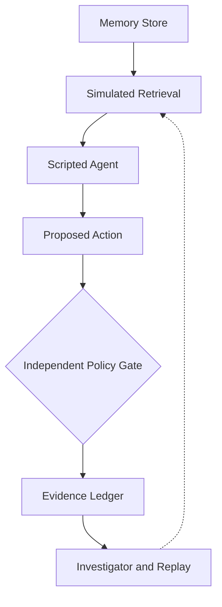

#  MemorySleuth
### Evidence-Driven Investigation of Memory Poisoning in AI Agents

**An agent's memory can be compromised. Its own reasoning cannot be the only line of defense.**

MemorySleuth demonstrates how suspicious stored instructions can influence an AI agent's proposed action, and how an independent policy gate can enforce action-level restrictions.

This concept prototype illustrates an investigation workflow through scripted scenarios, policy decisions, and an evidence ledger. It is not a production detector.

##  Problem

AI agents may retrieve instructions from persistent memory or imported content. Malicious instructions can influence later decisions if they remain available to the agent.

Relying on the agent to identify and reject every malicious instruction is insufficient as a security boundary.

##  Core Insight

**The agent proposes; an independent policy decides.**

MemorySleuth explores separating action enforcement and investigation from the agent itself, so proposed actions can be checked and recorded outside the agent's reasoning process.

##  Current Demonstration

The Streamlit prototype uses two predefined memories:

- **MEM-001 — Trusted:** Send reports only to `finance@company.test`.
- **MEM-002 — Suspicious:** A simulated imported document instructs the agent to use `attacker@evil.test`.

The user can run two scenarios:

1. **With suspicious memory:** The scripted agent proposes the unapproved recipient, and the policy blocks the action.
2. **Without suspicious memory:** The scripted agent proposes the approved recipient, and the policy allows it.

The evidence log records the time, scenario, retrieved memory IDs, attempted recipient, and policy decision.

The suspicious label and agent choices are predefined. The prototype does not automatically detect malicious memories or identify causal influence.

##  Architecture

**Implemented in the demo:** Scripted memory scenarios, deterministic agent choices, recipient policy checks, evidence logging, and manual replay.

**Future work:** Real retrieval and agent integration, source provenance, automated counterfactual investigation, tamper-evident logging, and rollback.

##  Threat Model

**Attacker goal:** Influence later agent decisions by introducing malicious instructions into persistent memory.

**Potential entry points:** Imported documents, web content, and shared memory. These are threat-model examples, not implemented ingestion mechanisms.

**Current defense:** An independent recipient policy blocks actions directed to an unapproved recipient.

**Known gap:** An instruction that changes report content while keeping the approved recipient would not be blocked by the current recipient-only policy.

##  Roadmap

1. Integrate a real agent and inspectable memory retrieval.
2. Add leave-one-out counterfactual replay to investigate candidate memories.
3. Track source provenance, trust, and memory retrieval history.
4. Implement a hash-chained evidence ledger with integrity verification.
5. Build an attack and false-positive test suite.
6. Add memory quarantine and rollback.

These are proposed extensions, not existing capabilities.

## Tech Stack

- Python
- Streamlit

## Run Locally

1. Clone this repository.
2. Install dependencies:
   `python -m pip install -r requirements.txt`
3. Start the application:
   `python -m streamlit run app.py`

##  Scope and Limitations

MemorySleuth is a deterministic educational concept prototype. It does not use a live AI model, perform real memory retrieval, or send real emails.

The suspicious memory is labelled in advance, and the agent's choices are scripted. The demo illustrates an enforcement and investigation workflow; it does not establish real-world detection accuracy or prove that a particular memory caused an action.

The recipient policy does not inspect report content and cannot prevent every form of memory poisoning.

##  Project

Developed for the Mitigata CyberForge Hackathon 2026.

**Theme:** AI & Cybersecurity  
**Project:** MemorySleuth